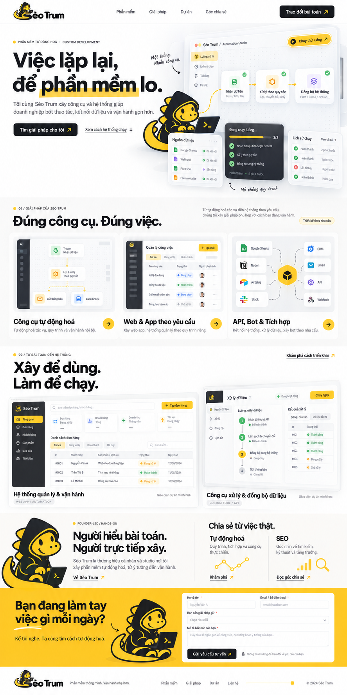

# Sèo Trum — Đặc tả thiết kế và tương tác trang chủ

Phiên bản 1.0 · 20/10/2026 · Ngôn ngữ giao diện: tiếng Việt.

Tài liệu này là hợp đồng thiết kế để Gemini hoặc một lập trình viên triển khai trang chủ. Đây là đặc tả, chưa phải website đã chạy hoặc bằng chứng form đã nhận khách hàng.

## 1. Đích đến và thứ tự ưu tiên

Xây một website khiến khách hiểu ngay: **Sèo Trum cung cấp và xây phần mềm tự động hoá, ứng dụng, bot và công cụ theo bài toán thực tế.** Sèo Trum đồng thời là thương hiệu cá nhân của người trực tiếp xây và tên studio. SEO là trụ cột kiến thức và hướng mở rộng, chưa được trình bày như dịch vụ đã có thành tích.

Mục tiêu chuyển đổi: khách mô tả nhu cầu và gửi yêu cầu tư vấn/báo giá. Chưa có danh mục sản phẩm, bảng giá, khách hàng, hồ sơ founder hay backend được xác minh trong brief này.

Ưu tiên khi có xung đột:

1. Đúng thương hiệu, đúng chuyên môn, nội dung trung thực, sử dụng được.
2. Bám cấu trúc và phối màu của ảnh tham chiếu khủng long vàng.
3. Typography, tỷ lệ, bố cục, responsive và tương tác có chủ đích.
4. Hiệu ứng trang trí, chỉ giữ nếu không ảnh hưởng ba mục trên.

“Đỉnh” ở đây là khách hiểu và thử được ý tưởng tự động hoá qua giao diện; không đánh đổi bằng nhiều hiệu ứng hoặc một cảnh 3D xa chuyên môn.

## 2. Nguồn chuẩn và tài sản



| Tài sản | Vai trò | Quy định |
|---|---|---|
| `assets/homepage-reference.png` | Chuẩn bố cục, phân cấp, tương quan trắng/vàng/đen | Xem bằng mắt trước khi viết giao diện. Không đặt nguyên screenshot làm website. |
| `assets/brand-logo.png` | Logo ngang có chữ Sèo Trum, PNG có alpha | Giữ hình, màu, dấu tiếng Việt. Không gõ tên đè lên logo hoặc thay bằng icon khác. |
| `assets/brand-mascot.png` | Khủng long vàng mặc hoodie, dùng laptop | Dùng ở hero và founder; phiên bản nhỏ ở CTA là tùy chọn. Không đổi thành robot. |

Ảnh đầu trang logo có thể có khoảng trong suốt dư. Được **trim theo alpha và tạo bản WebP/PNG tối ưu** để căn chỉnh, giữ nguyên tỷ lệ và hình. Giữ file gốc. Không kéo méo, không vẽ lại logo bằng font gần giống. Các file hiện là raster, không gọi là SVG/vector. Chỉ tạo favicon đơn giản từ mascot nếu đọc rõ ở 32px; nếu không, báo cần phiên bản icon giản lược riêng.

Khác biệt được phép so với ảnh: sửa chữ sai, năm copyright, độ tương phản; thay nhãn ví dụ; sắp lại trên mobile; giảm chi tiết dashboard khó đọc. Không đổi nhận diện hoặc cấu trúc chính.

## 3. Phạm vi triển khai

### Có trong phiên bản đầu

- Trang chủ đầy đủ, responsive, menu mobile.
- Hero có workflow tương tác chạy bằng dữ liệu mẫu cục bộ.
- Ba nhóm giải pháp, hai mẫu dự án có nhãn minh hoạ, giới thiệu founder, hai lối vào kiến thức.
- Form tư vấn với validation và các trạng thái rõ ràng.
- Điều hướng trong trang, chọn trước nhóm nhu cầu, xem mô tả giải pháp/dự án.
- Hệ thống token, component, motion, tối ưu tài sản và báo cáo kiểm tra.

### Chưa đưa vào phạm vi mặc định

Thanh toán, cấp license, đăng nhập, admin/CMS, dịch vụ SEO có cam kết, kết nối CRM thật, đăng bài tự động hoặc chatbot dùng LLM. Không tự dựng thêm các hệ thống này để làm đầy trang.

Nếu repository đã có module hoặc backend liên quan, đọc và tái sử dụng trước; không tạo bản sao song song. Không triển khai/publish ra bên ngoài trong nhiệm vụ xây giao diện nếu chưa được giao.

## 4. Hệ thống thị giác

### 4.1 Màu sắc

| Token | Giá trị | Cách dùng |
|---|---|---|
| `--page` | `#FFFFFF` | Nền chính, khoảng thở, footer |
| `--surface` | `#F6F7F8` | Mặt nền demo và preview |
| `--surface-warm` | `#FFFCF1` | Vùng founder rất nhẹ, không phủ toàn trang |
| `--ink` | `#202326` | Chữ, nút chính, thanh trạng thái demo |
| `--muted` | `#5B6068` | Body phụ và metadata đọc được |
| `--border` | `#E5E7EB` | Đường phân cách, input, panel |
| `--brand` | `#FFC62A` | Điểm nhấn, đường tín hiệu, section liên hệ |
| `--brand-hover` | `#F0B900` | Trạng thái hover trên nền vàng |
| `--success` | `#217A48` | Thành công, đi cùng icon/chữ |
| `--error` | `#B42318` | Lỗi, đi cùng thông báo |

Trắng chiếm khoảng 75–85% tổng bề mặt cảm nhận. Vàng tập trung ở mascot, active state và vùng liên hệ cuối trang. Nút vàng dùng chữ than đậm; không dùng chữ vàng nhỏ trên trắng. Các màu icon tích hợp có thể khác nhưng không chiếm quyền chủ đạo.

### 4.2 Typography

- Chọn **Be Vietnam Pro** cho heading và nội dung, kiểm tra đủ glyph tiếng Việt. Tự host nếu hạ tầng cho phép; chỉ tải weight cần dùng 400/500/600/700/800 hoặc một variable font phù hợp. Fallback `system-ui, sans-serif`.
- Heading mạnh nhưng không nặng đều toàn trang. H1 750–800 nếu font hỗ trợ, heading section 650–750; body 400–500.
- H1 desktop 60–76px, line-height 1.06–1.12, tracking khoảng -0.035em; tablet 44–58px; mobile 36–44px, line-height 1.12. Không cắt dấu tiếng Việt.
- H2 desktop 36–48px, mobile 28–34px. H3 20–24px; body 16–18px, line-height 1.55–1.7. Nhãn dữ liệu demo có thể 12–14px, không thu nhỏ toàn website để giống screenshot.
- Tối đa khoảng 65–75 ký tự cho đoạn đọc dài. Không ép `<br>` desktop lên mobile; dùng breakpoint và độ rộng khối để kiểm soát xuống dòng.
- Chỉ giữ nhấn vàng dưới cụm “phần mềm” của H1 theo ảnh; không lặp cách nhấn một từ ở mọi heading. Nhãn section dùng ngắn gọn; không cần sao chép mọi chữ hoa/số 01, 02 trong ảnh.

### 4.3 Lưới và khoảng cách

- Container desktop tối đa 1280px; viewport lớn hơn giữ nền rộng, không kéo body text vô hạn. Lề 32–64px desktop, 24px tablet, 20px mobile, 16px ở 360px nếu cần.
- Grid 12 cột desktop, gap 24–32px. Hero chia khoảng 5/7; preview có thể tràn sang phải nhưng không gây horizontal scroll.
- Section padding block 88–112px desktop, 64–80px tablet, 48–64px mobile. Khoảng cách từ heading đến nội dung 28–40px.
- Thang spacing: 4, 8, 12, 16, 20, 24, 32, 40, 48, 64, 80, 96.
- Radius: nút/input 10–12px; panel công cụ 16–20px; stage lớn tối đa 24px. Không mọi thành phần đều bo pill.
- Border 1px. Shadow nhẹ: `0 16px 48px rgba(32,35,38,.08)` ở hero/stage; node nhỏ nhẹ hơn. Không phủ shadow dày lên mọi card.
- Layer: nội dung 0; panel 10; mascot/chip trong hero 20; header 40; dialog/menu 80; thông báo 100. Tạo stacking context có chủ đích.

## 5. Bố cục và nội dung từng phần

### 5.1 Header — `#top`

Logo bên trái; menu “Phần mềm”, “Giải pháp”, “Dự án”, “Góc chia sẻ”; nút “Trao đổi bài toán”. Header desktop khoảng 80–88px, mobile 68–76px. Slot logo sau trim khoảng 164–184px rộng desktop và 138–152px mobile; ưu tiên giữ logo rõ thay vì bó vào chiều cao quá thấp.

Header sticky nền trắng ổn định. Sau khoảng 24px cuộn mới thêm đường viền/shadow rất nhẹ, không co giật chiều cao. Mỗi section anchor đặt `scroll-margin-top` bằng chiều cao header + 16px.

Mobile dùng menu button có tên truy cập, `aria-expanded`, menu đóng được bằng Escape, chọn link thì đóng và chuyển focus đúng. Nếu dùng modal drawer, quản lý focus và trả focus về nút mở. Không chỉ có icon không tên.

### 5.2 Hero — dấu ấn chính

**H1:** “Việc lặp lại, để phần mềm lo.”

**Đoạn hỗ trợ:** “Tôi cùng Sèo Trum xây công cụ và hệ thống giúp doanh nghiệp bớt thao tác, kết nối dữ liệu và vận hành gọn hơn.”

**CTA:** “Tìm giải pháp cho tôi” → form tư vấn; “Xem cách hệ thống chạy” → vùng demo, đưa nút chạy vào vị trí nhìn thấy, không tự gửi dữ liệu.

Desktop: copy bên trái khoảng 44%, workspace bên phải khoảng 56%. Chỉ panel ngoại vi nghiêng tối đa 2–3°; node, chữ và nút chính nằm trên mặt dễ đọc. Mascot khoảng 180–240px rộng, đứng ở giao điểm giữa copy và workspace, không đè H1/CTA. Phải nhìn rõ phần mềm và luồng xử lý, không chỉ một mascot lớn.

Workspace gồm:

- Toolbar “Sèo Trum / Automation Studio”, nút “Chạy thử luồng”.
- Canvas ba node: “Nhận dữ liệu” → “Xử lý theo quy tắc” → “Đồng bộ hệ thống”.
- Đường nối vàng, node đang chạy có viền/tín hiệu; node xong có dấu check và chữ.
- Panel “Nguồn dữ liệu”: dữ liệu mẫu từ “Biểu mẫu”, “Bảng tính”, “Webhook”. Đây là nhãn minh hoạ, không ngụ ý đã tích hợp với tài khoản thật.
- Panel than đậm “Tiến trình”: ba bước và bộ đếm 0/3 đến 3/3.
- Panel “Lịch sử mô phỏng”: hiển thị kết quả của lần chạy trong phiên hiện tại, không tự tạo lịch sử chạy thật giả.
- Nhãn luôn hiện: **“Mô phỏng quy trình — dữ liệu mẫu”**.

Nếu trong ảnh có icon sản phẩm bên ngoài, ưu tiên icon chính thức có quyền sử dụng hoặc thay bằng tên chữ/icon loại dữ liệu. Không vẽ nhái logo và không đưa vào dải “đối tác”.

### 5.3 Giải pháp — `#phan-mem` và `#giai-phap`

Heading: **“Đúng công cụ. Đúng việc.”**

| Nhóm | Mô tả ngắn | Preview có chủ đích |
|---|---|---|
| Công cụ tự động hoá | “Tự động hoá tác vụ, quy trình và vận hành nội bộ.” | Luồng nhận dữ liệu, xử lý và thông báo |
| Web & App theo yêu cầu | “Xây ứng dụng và hệ thống quản lý theo quy trình riêng.” | Bảng công việc và trạng thái |
| API, Bot & Tích hợp | “Kết nối hệ thống, xử lý dữ liệu, xây bot theo nhu cầu.” | Một hub nối các loại hệ thống |

Ba cột cùng baseline tên và CTA, nhưng mini UI khác nhau để thể hiện năng lực. Preview có chiều cao gần nhau, không mỗi cột một icon to. Badge “Thiết kế theo nhu cầu”. Không tự thêm giá, gói thuê bao, “Mua ngay”, nút tải phần mềm chưa tồn tại.

Chọn nhóm mở phần mô tả ngay dưới hoặc dialog chi tiết ngắn với ví dụ bài toán. Nút “Trao đổi nhu cầu này” đi tới form và chọn trước nhóm. Giữ hover/focus cùng affordance; touch có thao tác tương đương.

Anchor `#phan-mem` ở đầu vùng giải pháp; `#giai-phap` ở danh sách nhóm. Không tạo hai section trùng nội dung chỉ để đủ menu.

### 5.4 Dự án — `#du-an`

Heading: **“Xây để dùng. Làm để chạy.”**

Hai preview theo ảnh, tỷ lệ desktop khoảng 58/42; bên phải lệch lên/xuống tối đa 24px, không tạo khoảng trắng vô lý. Tên:

1. “Hệ thống quản lý & vận hành” — Web App / Automation.
2. “Công cụ xử lý & đồng bộ dữ liệu” — Custom Tool / API.

Vì chưa có case study thật, mỗi preview ghi **“Giao diện dự án minh hoạ”**. Các bảng chỉ dùng dữ liệu giả trung tính như “Khách hàng mẫu”, không dùng thông tin liên hệ có vẻ của người thật. Không chép con số doanh thu, tỷ lệ thành công, số khách hàng từ ảnh.

Click mở dialog **“Khái niệm giải pháp minh hoạ”** với bài toán ví dụ, luồng xử lý, đầu ra dự kiến và CTA tư vấn. Không gọi mô tả này là kết quả khách hàng đã đạt. Khi được cấp case study thật, thay bằng route chi tiết thực.

Preview có thể dựng bằng HTML/CSS hoặc dùng screenshot riêng đã cấp; không crop toàn ảnh homepage thành fake tương tác.

### 5.5 Founder và kiến thức — `#ve-seo-trum`, `#goc-chia-se`

Giữ cùng một dải desktop theo ảnh nhưng chia hai khối ngữ nghĩa độc lập. Khối founder khoảng 55%, kiến thức khoảng 45%; mobile xếp dọc.

Founder: mascot nhìn vào nội dung; heading **“Người hiểu bài toán. Người trực tiếp xây.”**; đoạn “Sèo Trum là thương hiệu cá nhân và studio nơi tôi xây phần mềm tự động hoá, từ ý tưởng đến vận hành.” Không tự thêm tên thật, ảnh chân dung, số năm kinh nghiệm hoặc chứng chỉ.

CTA “Về Sèo Trum” mở giới thiệu ngắn trong trang. Tên founder chi tiết chỉ xuất hiện khi người dùng cung cấp.

Kiến thức: heading **“Chia sẻ từ việc thật.”** Hai lối vào:

- **Tự động hoá:** “Quy trình, tích hợp và công cụ thực chiến.”
- **SEO:** “Góc nhìn về tìm kiếm, kỹ thuật và tăng trưởng.”

Không tạo bài viết giả. Nếu chưa có bài/route thật, nút mở nội dung giới thiệu chủ đề trong trang và CTA “Trao đổi về chủ đề này”; nói rõ “Nội dung đang được chuẩn bị” khi chưa có nội dung. Không dùng link chết hoặc âm thầm dẫn cả hai về cùng trang không liên quan.

### 5.6 Form tư vấn — `#tu-van`

Nền vàng nhận diện, chữ than đậm. Heading **“Bạn đang làm tay việc gì mỗi ngày?”**; hỗ trợ **“Kể tôi nghe. Ta cùng tìm cách tự động hoá.”** Mascot nhỏ trang trí chỉ thêm nếu form còn thoáng.

Desktop khoảng 43/57 giữa copy và form; mobile copy ở trên. Form nền trắng, padding 24–32px, không nổi nặng như popup quảng cáo.

| Trường | Điều kiện | Hướng dẫn |
|---|---|---|
| Họ và tên | Bắt buộc, 2–100 ký tự sau trim | Autocomplete name |
| Email / Số điện thoại | Bắt buộc | Chấp nhận email hoặc số điện thoại có khoảng trắng, +, ngoặc; kiểm tra hợp lý, không giới hạn cứng định dạng Việt Nam |
| Bạn cần giải pháp gì? | Bắt buộc | Tự động hoá / Web & App / API, Bot & Tích hợp / SEO / Chưa rõ, cần tư vấn |
| Mô tả bài toán | Bắt buộc, 20–3000 ký tự sau trim | Textarea; gợi ý quy trình hiện tại, đầu vào và kết quả mong muốn |

Nút **“Gửi yêu cầu tư vấn”**. Dòng dưới: “Thông tin chỉ dùng để trao đổi về yêu cầu của bạn.” Chính sách chi tiết chỉ liên kết khi có trang thật.

Trạng thái: pristine → editing → invalid hoặc submitting → success/error. Lỗi gắn với field, có mô tả chữ; focus trường sai đầu tiên. Chặn gửi trùng khi pending; lỗi server giữ dữ liệu và cho thử lại. Chỉ success khi backend xác nhận đã tiếp nhận/lưu hoặc chuyển tiếp thành công; không dùng timeout để giả gửi.

**Nếu chưa có backend:** giao diện chạy ở `preview` mode; vẫn validation, nhưng nút ghi “Kiểm tra yêu cầu (bản xem trước)”, thông báo rõ “Yêu cầu hợp lệ. Bản xem trước chưa gửi dữ liệu.” Không gọi email/CRM/webhook ngẫu nhiên và không tuyên bố đã nhận lead. Nếu dự án đã có endpoint thật, tích hợp theo contract của nó; cấu hình môi trường tách riêng. Trước public cần backend, chống spam phù hợp và policy thực. Đây là ranh giới công việc, không phải yêu cầu xây cả CRM.

### 5.7 Footer

Logo gốc, “Phần mềm thông minh. Vận hành nhẹ hơn.”, điều hướng nội trang, copyright dùng năm hiện hành. **Không giữ năm 2024 do ảnh sinh tự động.** Không bịa địa chỉ/email/hotline hoặc liên kết mạng xã hội.

## 6. Workflow demo — tương tác chủ lực

Đây là mô phỏng thật bằng UI state và dữ liệu cục bộ, không phải tích hợp hệ thống khách hàng. Nút click có phản hồi rõ; người đọc được chủ động thử thay vì nhìn particle chạy vô hạn.

### 6.1 Dữ liệu và trạng thái

Dữ liệu cố định không chứa PII: `REQ-001`, loại `Yêu cầu tư vấn`, nhóm `Tự động hoá`, trạng thái `Mới`. Giải thích đây là mẫu khi mở demo.

State machine: `idle → receiving → processing → syncing → complete`; `running` là trạng thái tổng của ba bước giữa. Không có request mạng trong demo.

| Mốc từ khi nhấn | State | Giao diện |
|---|---|---|
| 0–100ms | receiving | Nút thành “Đang chạy mô phỏng”, progress 0/3; chặn nhấn lặp |
| 100–850ms | receiving | Một tín hiệu vàng đi đến node 1; dòng dữ liệu mẫu xuất hiện |
| 850–1750ms | processing | Node 1 check, progress 1/3; node 2 xử lý phân loại, không đổi kích thước panel |
| 1750–2650ms | syncing | Node 2 check, progress 2/3; node 3 hiển thị cập nhật đầu ra cục bộ |
| 2650–3200ms | complete | Check 3/3, một dòng lịch sử “Mô phỏng hoàn tất”; nút “Chạy lại” |

Các mốc là target thiết kế, được lệch ±15% nếu nhìn mượt hơn; không dùng để giả thời gian xử lý backend. Không autoplay workflow. Trước khi click, đường nối tĩnh và trạng thái `Sẵn sàng mô phỏng`.

Có nút “Đặt lại” hoặc chọn “Chạy lại” để trở về mẫu rồi chạy chu kỳ mới. Tối đa ba dòng lịch sử cục bộ; không tăng KPI giả. Reload trang reset phiên là bình thường.

Không tạo `aria-live` cho mọi hạt/tín hiệu hoặc mọi frame. Thông báo lịch sự “Đang chạy mô phỏng” khi bắt đầu và “Mô phỏng hoàn tất” khi kết thúc. Hủy timer/animation khi component unmount. Tab ẩn thì tạm dừng với thời gian còn lại, không cập nhật dồn sai thứ tự khi quay lại.

Reduced motion: click chạy đủ logic cùng thứ tự nhưng không có tín hiệu bay, tilt hay nhấp nháy; chuyển trạng thái chữ/check nhanh, hoàn tất khoảng 300–500ms, không bỏ nhãn “mô phỏng”.

### 6.2 Điều khiến demo trông cao cấp

- Node, connector, progress và lịch sử đọc cùng một state machine; không bốn animation rời chạy ngẫu nhiên.
- Lớp nền có dot grid rất nhạt; panel trắng có độ sâu bằng border/shadow, không blur quá mức.
- Chỉ active node dùng vàng mạnh. Kết quả xuất hiện theo thứ tự, người dùng nhìn được quan hệ nguyên nhân–kết quả.
- Mascot giữ vai trò người xây; không nhảy liên tục và không bật chatbot tự phát.
- Mọi trạng thái có bố cục ổn định. Khách có thể cuộn xuống bất cứ lúc nào.

## 7. Motion và effect — thông số thực hiện

### 7.1 Nguyên tắc chung

Một nhịp xuất hiện đầu trang và một demo do khách điều khiển là hai điểm chính. Phần còn lại giữ yên hoặc phản hồi ngắn khi thao tác. Không gắn cùng fade-up vào mọi thẻ, không smooth-scroll hijack, không custom cursor che chuột, không âm thanh tự phát, không WebGL/3D scene hoặc particle nền nặng.

Token gợi ý: `fast=160ms`, `normal=240ms`, `reveal=520ms`; `ease-out=cubic-bezier(.22,1,.36,1)`; `ease-ui=cubic-bezier(.2,.8,.2,1)`. Pointer animation chỉ bật khi `(hover: hover) and (pointer: fine)` và không reduced motion.

| ID | Effect và mục đích | Trigger / biên độ / thời lượng | Mobile, reduced motion và fallback |
|---|---|---|---|
| E01 | Hero xuất hiện có nhịp, vẫn đọc ngay | Copy/CTA đã hiện từ đầu; chỉ dịch tối đa 8px trong 400–520ms. Workspace từ translateY 18px + scale .985 về chuẩn, delay 80ms, 600ms. Tổng không vượt 800ms. | Mobile giảm translate 8px; reduced motion hiện ngay. Không opacity 0 cho H1/ảnh LCP. |
| E02 | Vệt vàng dưới “phần mềm” | Pseudo-element scaleX 0→1, origin left, 420ms, chạy một lần sau font sẵn hoặc ngay nếu fallback. Chữ luôn hiện. | Reduced motion vệt tĩnh. Không vẽ lại mọi lần cuộn. |
| E03 | Workspace chiều sâu nhẹ | Pointer trong workspace, tối đa rotateX/rotateY ±2°, translate 4px; hồi vị 250ms khi rời. Dùng một wrapper và `requestAnimationFrame`. | Tắt trên touch/reduced motion. Không áp cho toàn trang; button hitbox vẫn ổn định. |
| E04 | Tín hiệu vàng theo connector | Chỉ khi click Chạy thử; 1 tín hiệu trên đoạn đang xử lý, 600–900ms. SVG path + dash/marker; gắn state E-demo. | Mobile connector xếp dọc; reduced motion chỉ đổi active state. Fallback đường tĩnh. |
| E05 | Node và log phản hồi | Active border vàng 180ms; check vào opacity/scale .96→1 trong 160ms; dòng log chuyển opacity 0→1 và y 4→0 trong 180ms. | Giữ chiều cao vùng log để không giật; reduced motion chữ/check đổi trực tiếp. |
| E06 | Mascot tham gia khi chạy | Khi receiving, toàn PNG dịch y -3px rồi về trong 350ms; complete nhấc tối đa 2px một lần. Không giả chuyển động mắt/tay vì chưa có sprite. | Mobile có thể tắt; reduced motion tĩnh. Không cắt rời bộ phận từ PNG hoặc vẽ mặt mới. |
| E07 | Nút chính phản hồi | Hover đổi màu nền/border 160ms; arrow dịch x 3px; press scale .985 trong 80ms; focus vòng than/vàng rõ. | Touch chỉ press; reduced motion không scale. Không magnetic hút theo chuột. |
| E08 | Explorer thể hiện lựa chọn | Hover/focus nhấn viền và đường tín hiệu preview; chọn mở mô tả 200–260ms, layout ổn định. Preview đứng yên trước thao tác. | Tap mở tương đương. Reduced motion mở ngay. Không auto chạy ba preview. |
| E09 | Project preview zoom nhẹ | Hover/focus ở desktop, chỉ ảnh bên trong scale 1.015 trong 320ms và link sáng rõ; frame không di chuyển. | Mobile và reduced motion không zoom; luôn hiện nhãn và link. |
| E10 | Dải founder/knowledge vào viewport | Một chuyển trạng thái opacity .85→1, 360ms, một lần; không translate mọi đoạn chữ. | Nội dung vốn đã đọc được, observer lỗi vẫn hiện. Reduced motion tĩnh. |
| E11 | Form và submit | Focus input border đổi 160ms; loading chỉ icon nhỏ và chữ; success/error inline hiện 160ms sau kết quả thật. | Không rung input, không confetti, không xoá dữ liệu khi lỗi. Preview không giả success. |
| E12 | Menu mobile | Panel trượt y 8px + opacity trong 180–220ms, overlay nhẹ; không full-screen 3D transition. | Reduced motion mở/đóng ngay; Escape/backdrop và focus hoạt động. |

E01, E02, E04, E05, E07, E11, E12 là cốt lõi. E03, E06, E09, E10 là polish tùy chọn; bỏ chúng trước nếu có vấn đề hiệu năng. E08 cần hành vi chọn, animation có thể bỏ. Không cài hai motion library để làm những effect này.

Ưu tiên CSS transform/opacity; dùng SVG cho đường nối. Theo dõi visibility bằng Intersection Observer để dừng công việc khi không nhìn thấy; cleanup observer và listener. Chỉ đặt `will-change` trên wrapper đang chuyển động rồi gỡ; không áp cho mọi section.

## 8. Responsive và tiếp cận

| Viewport | Bố cục chính | Demo |
|---|---|---|
| ≥1200px | Hero 5/7; giải pháp ba cột; dự án 58/42; founder/knowledge cùng dải | Node ngang, tối đa ba panel phụ, mascot ở giao điểm |
| 768–1199px | Header chuyển menu nếu thiếu chỗ; hero copy trên hoặc 45/55 khi đủ; giải pháp 2+1 cột; dự án hai cột khi nội dung đọc rõ | Một panel nguồn và một panel trạng thái; bỏ lớp nghiêng ngoại vi |
| 360–767px | Một cột; copy → CTA → demo; dịch vụ/dự án xếp dọc; founder rồi kiến thức; form cuối | Node xếp dọc. Chỉ progress và log mới nhất; nguồn gộp thành hàng nhãn. Mascot 100–144px, không che thao tác |

- Kiểm tra tối thiểu 360, 390, 768, 1024, 1440px. Ở 390px, khách đọc được H1 và CTA trước khi phải đi qua một dashboard quá dài. Demo mobile cao khoảng 360–460px, co nội dung phụ thay vì thu chữ xuống 9px.
- Button/control có vùng chạm tối thiểu 44×44px, kể cả icon menu và arrow.
- Một H1; heading có thứ bậc; `header/nav/main/section/footer`, link để điều hướng, button để chạy/thay đổi trạng thái.
- Focus nhìn thấy; các trạng thái không chỉ dùng màu. Mục tiêu tương phản AA: chữ thường tối thiểu 4.5:1, chữ lớn 3:1. Kiểm tra thực tế, không suy đoán từ màu thương hiệu.
- Dialog có tên, focus trap đúng nếu modal, Escape đóng, trả focus về nơi mở. Desktop nav vẫn sử dụng bằng bàn phím.
- Ảnh trang trí `alt=""`; logo có tên thương hiệu; không đọc lặp caption mascot nhiều lần.
- Không dùng CSS `overflow-x:hidden` toàn trang để che lỗi layout. Fix nguồn gây tràn; clip hiệu ứng cục bộ nếu có chủ đích.
- `prefers-reduced-motion` áp dụng cả CSS và JS. Khi đổi preference trong phiên, hủy effect không cần thiết; dữ liệu/UI vẫn hoạt động.

## 9. Kiến trúc nội dung và SEO

Phiên bản đầu chỉ bắt buộc trang chủ hoạt động. Menu nội trang không được trỏ vào các trang chưa xây. Chuẩn bị cấu trúc Hub-and-Spoke kép khi có nội dung thật:

| Route dự kiến | Vai trò | Điều kiện mở |
|---|---|---|
| `/dich-vu/` | Danh sách dịch vụ | Có nội dung mô tả cụ thể và CTA |
| `/du-an/` và `/du-an/<slug>/` | Bằng chứng triển khai | Có dự án thật hoặc nêu rõ là demo |
| `/tu-dong-hoa/` | Pillar tự động hoá | Có nội dung hữu ích thực, không chỉ một hero |
| `/seo/` | Pillar SEO | Có nội dung hữu ích thực, tránh ngụ ý cam kết thứ hạng |
| `/bai-viet/<slug>/` | Spoke kiến thức | Có bài viết được cung cấp/biên soạn và duyệt |

Dịch vụ liên kết đến dự án chứng minh và bài hướng dẫn liên quan; bài viết quay lại pillar và dịch vụ phù hợp. Không tạo hàng loạt route placeholder để lấp sitemap.

Trang chủ: title đề xuất “Sèo Trum — Phần mềm tự động hoá & ứng dụng theo yêu cầu”; description “Xây công cụ, web app, bot và hệ thống tích hợp giúp doanh nghiệp giảm thao tác thủ công. Trao đổi bài toán cùng Sèo Trum.” Sửa theo nội dung thực khi triển khai.

HTML phải có nội dung đọc được trước animation; nếu là dự án mới, ưu tiên render tĩnh/SSR phù hợp với stack. Canonical/OG URL/sitemap chỉ dùng domain đã cấu hình, không bịa domain. Structured data chỉ thêm dữ liệu tổ chức/người đã xác minh; không tự thêm AggregateRating, review hay giá. Preview chưa sẵn sàng public dùng cơ chế noindex của môi trường triển khai.

## 10. Tổ chức triển khai

### Dự án có sẵn

Đọc hướng dẫn repository, xác định framework, router, styling, motion và form hiện có. Giữ kiến trúc/lockfile; scope thay đổi vào homepage, component và asset liên quan. Không nâng cấp framework hoặc sửa lint debt ngoài phạm vi để thực hiện thiết kế này.

### Dự án mới

Một lựa chọn mặc định hợp lý là React + TypeScript với giải pháp render tĩnh/SSR và CSS token hoặc hệ styling sẵn được chọn. Quyết định theo môi trường thực tế, ghi rõ lý do; không bắt buộc cài framework chỉ để theo tên công nghệ. CSS + SVG + state cục bộ đủ cho demo; tận dụng motion library đã có. Không cần Three.js, video hero hay game engine.

Ranh giới component gợi ý, đổi tên theo repository:

```text
HomePage
  SiteHeader / MobileMenu
  HeroSection
    AutomationPlayground
      WorkflowCanvas / WorkflowNode
      SourcePanel / RunProgress / RunHistory
      BrandMascot
  SolutionsSection / SolutionDetail
  ProjectShowcase / ProjectConceptDialog
  FounderSection / KnowledgeSection
  ConsultationSection / ConsultationForm
  SiteFooter
```

Nội dung solution/project tách khỏi markup; một config cho token và một nguồn state cho demo. Không dùng state render theo từng frame con trỏ; cập nhật CSS variables qua animation frame nếu dùng tilt. Giữ content HTML và asset thật; screenshot chỉ là reference.

## 11. Hiệu năng và điều kiện fallback

- Khai báo width/height hoặc aspect ratio cho ảnh, logo, demo stage; dự trữ chỗ cho log, field error và menu để tránh nhảy layout.
- Logo/mascot dùng kích thước responsive, tối ưu WebP/AVIF nếu giữ alpha/chất lượng; giữ PNG gốc. Ảnh homepage reference không được nạp ở trang public.
- Chỉ ưu tiên tải asset thực sự trên màn hình đầu. Asset dưới fold lazy-load. Không tải ba bản mascot full-resolution cho ba vị trí.
- H1 và nội dung chính không phải chờ animation, font hoặc JS mới xuất hiện; font fallback có tỷ lệ gần, `font-display: swap` hoặc chiến lược framework tương đương.
- Không nạp trọn thư viện icon, không vòng lặp animation không dừng, không blur backdrop trên panel lớn chỉ để trang trí.
- Ngân sách dự án tham khảo: JS client ban đầu ≤200KB gzip cho riêng trang chủ nếu có thể kiểm soát; logo+mascot trên fold ≤350KB tổng sau tối ưu. Nếu dependency nền đã vượt ngân sách, báo phần baseline/phần tăng thêm, không xoá tính năng khác hoặc bịa số.
- Mục tiêu Core Web Vitals thực địa: **LCP ≤2.5s, INP ≤200ms, CLS ≤0.1 ở phân vị 75**, tách mobile/desktop. Đây là mục tiêu, không phải kết quả đã đo. Lighthouse/local đo tải và lab không chứng minh INP thực địa đã đạt.
- Khi không có observer hoặc animation hỗ trợ, hiện nội dung và đường nối tĩnh; demo vẫn đổi state được. Khi JS tắt, nội dung/điều hướng/form notice vẫn đọc được; demo mô tả tĩnh.

## 12. Quy trình và cổng nghiệm thu cho Gemini

### A — Xác minh đầu vào

Mở ảnh tham chiếu và hai asset; đọc toàn bộ tài liệu. Tóm tắt 6 điểm: chuyên môn, màu, mascot, bố cục, điểm tương tác chính, ranh giới demo/backend. Nếu thiếu asset hoặc không xem được ảnh, tìm trong thư mục đầu vào; nếu vẫn thiếu, báo rõ, không tự thay bằng emoji hoặc mascot khác.

### B — Dựng hình tĩnh trước

Hoàn thành mọi section, font, tỷ lệ, spacing, asset và CTA. Tự xem ở 1440 và 390px, sửa khác biệt lớn với ảnh trước khi làm polish. Không dừng ở skeleton hoặc 3 section đầu.

### C — Tương tác có ý nghĩa

Thêm state machine demo, menu, chọn nhóm, dialog và validation; kết nối form thật chỉ khi có contract/backend được cung cấp. Kiểm tra đồng bộ state thay vì chỉ thấy đèn nhấp nháy.

### D — Motion có giới hạn

Thêm E01/E02/E04/E05/E07/E11/E12 rồi kiểm tra; chỉ thêm polish tùy chọn khi không ảnh hưởng đọc, thao tác và hiệu năng. Giảm effect trước khi làm giảm nội dung quan trọng.

### E — Kiểm tra và sửa

Đọc scripts thật trong manifest. Chạy lint/typecheck/build và test phù hợp hiện có. Ví dụ `npm run build` chỉ chạy khi script đó tồn tại; Windows dùng `npm.cmd` nếu cần. Không bịa kết quả hoặc tạo script rỗng để “pass”. Lỗi nền ngoài phạm vi ghi rõ.

| Gate | Điều phải chứng minh |
|---|---|
| Thị giác | Ảnh chụp 1440px và 390px + kiểm tra thêm 360/768/1024; đúng logo, chữ, palette, tất cả section, CTA nổi bật, không tràn ngang |
| Demo | Idle, nhận, xử lý, đồng bộ, xong, chạy lại; bấm nhanh không nhân timer; reload không hiện KPI giả; tab ẩn/reduced motion không sai state |
| Điều hướng | Mỗi link có đích thật/in-page/dialog; menu mobile dùng được, Escape/focus đúng |
| Form | Chấp nhận email hoặc điện thoại; invalid focus đúng; lỗi giữ dữ liệu; không double submit; preview không báo đã gửi; success chỉ khi API xác nhận |
| Accessibility | Keyboard, focus, labels, dialog, contrast; reduced motion; touch không lệ thuộc hover |
| Kỹ thuật | Kết quả build/typecheck/lint hiện có, không console error do thay đổi; cleanup timer/observer/listener |
| Hiệu năng | Ghi cách đo và môi trường; asset dimensions, lazy-loading; báo lab/field riêng, không suy diễn |

Ưu tiên test hành vi workflow và form; không viết test hàng loạt chỉ để soi lại class CSS hoặc số lượng thẻ. Có thể dùng browser automation sẵn trong repo; nếu thiếu trình duyệt/runtime, báo không kiểm tra trực quan được, không dựng bằng chứng ảnh giả.

### F — Bàn giao

Báo: file đã thay đổi, preview local nếu có, ảnh desktop/mobile, tương tác hoạt động, lệnh và kết quả đã chạy, phần chưa xác minh. Nêu rõ form đang preview hay đã kết nối thật. Không gọi là “production-ready”, “pixel-perfect” hoặc “đỉnh nhất” chỉ vì build thành công.

### Khi nào cần dừng một phần phụ thuộc

Thiếu tài sản gốc; backend nhận lead chưa có; dữ liệu dự án/chứng chỉ chưa xác minh; chuẩn bị publish nhưng chưa được giao. Hoàn thành các phần độc lập vẫn làm được rồi báo đúng thiếu gì. Không hỏi lại màu, logo, bố cục hoặc CTA đã xác định ở tài liệu này.

## 13. Những lỗi phải chủ động tránh

- Quay về concept chrome/cổng vô cực hoặc giao diện lime/đen từ các mẫu đã bỏ.
- “Hiện đại hoá” bằng icon 3D, hero video, chữ bay và glassmorphism phủ khắp trang.
- Phóng mascot thành linh vật game/đồ chơi, hoặc đặt nó lặp lại trong mọi section.
- Dùng toàn screenshot làm `` rồi phủ nút lên; khách không đọc/tương tác được.
- Dán một bộ SaaS template, giữ gradient tím, số khách hàng, testimonial và bảng giá mặc định.
- Cho mọi panel đều floating/bobbing vô hạn, khiến mắt không có điểm nghỉ.
- Chép code terminal nội bộ ra marketing mà người mua không hiểu.
- Thêm sẵn logo tích hợp khiến khách tưởng có sản phẩm/kết nối đang bán khi chưa xác minh.
- Chỉ “giống ảnh” ở desktop, còn mobile co nhỏ nguyên dashboard.
- Nút bấm không làm gì; toast “đã gửi” giả; href trống; năm copyright sai.

## 14. Nguồn kỹ thuật và trạng thái tài liệu

Các timing, bố cục, token và ngân sách ở đây là **quyết định thiết kế cho dự án**, không phải tiêu chuẩn bắt buộc của nền tảng. Những cơ chế nền được đối chiếu với nguồn chính thức:

- [MDN — prefers-reduced-motion](https://developer.mozilla.org/en-US/docs/Web/CSS/Reference/At-rules/@media/prefers-reduced-motion): phát hiện ưu tiên giảm chuyển động để giảm hoặc thay effect không thiết yếu.
- [MDN — Intersection Observer API](https://developer.mozilla.org/en-US/docs/Web/API/Intersection_Observer_API): theo dõi phần tử vào/ra vùng nhìn để quyết định chạy/dừng công việc.
- [web.dev — Web Vitals](https://web.dev/articles/vitals): định nghĩa, ngưỡng và cách đánh giá thực địa của LCP, INP, CLS.

Nguồn chuẩn thị giác là ảnh và logo trong chính bộ tài liệu này. Chưa có website, benchmark, backend hay kết quả triển khai Gemini được xác minh trong tài liệu.
